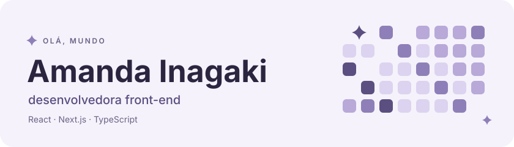
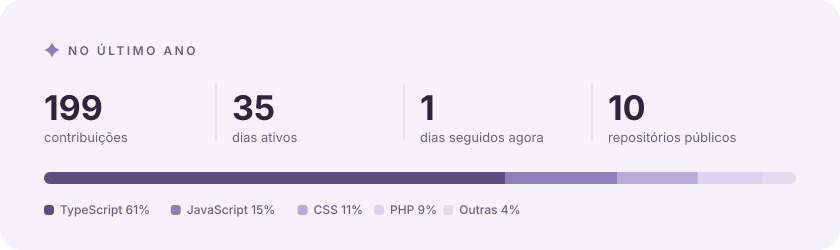

 

Estudante de Sistemas de Informação, construindo interfaces com React, Next.js e TypeScript.
Gosto dos detalhes que deixam uma tela agradável de usar, e de código organizado o bastante para outra pessoa entender de primeira.

[LinkedIn](https://www.linkedin.com/in/amanda-inagaki) &nbsp;·&nbsp; [Email](mailto:inagakilanding@gmail.com) &nbsp;·&nbsp; [Instagram](https://www.instagram.com/amandfsk)

 

### ✦ agora

<table>
  <tr>
    <td width="33%" valign="top">
      CONSTRUINDO 
      O projeto em que você está trabalhando agora
    </td>
    <td width="33%" valign="top">
      ESTUDANDO 
      O assunto que você está aprendendo agora
    </td>
    <td width="33%" valign="top">
      COMUNIDADE 
      He4rt, estudando e trocando com outras devs
    </td>
  </tr>
</table>

 

### ✦ stack

 

### ✦ projetos

<!-- Troque pelos seus projetos: nome, tecnologias, uma frase e os links -->

**Nome do projeto** &nbsp;Next.js · TypeScript 
Uma frase sobre o que ele faz e o detalhe de que você mais se orgulha. 
[ver online](https://link-do-projeto.vercel.app) &nbsp;·&nbsp; [código](https://github.com/inagakidev/nome-do-repo)

**Nome do projeto** &nbsp;React · CSS 
Uma frase sobre o que ele faz e o detalhe de que você mais se orgulha. 
[ver online](https://link-do-projeto.vercel.app) &nbsp;·&nbsp; [código](https://github.com/inagakidev/nome-do-repo)

 

### ✦ números

 

✦ obrigada por passar por aqui
